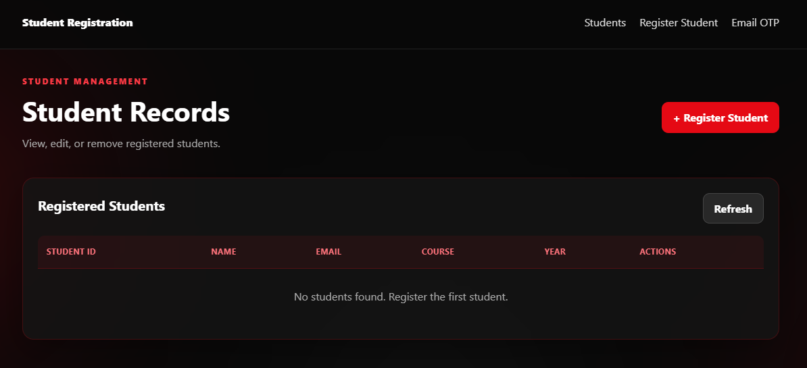
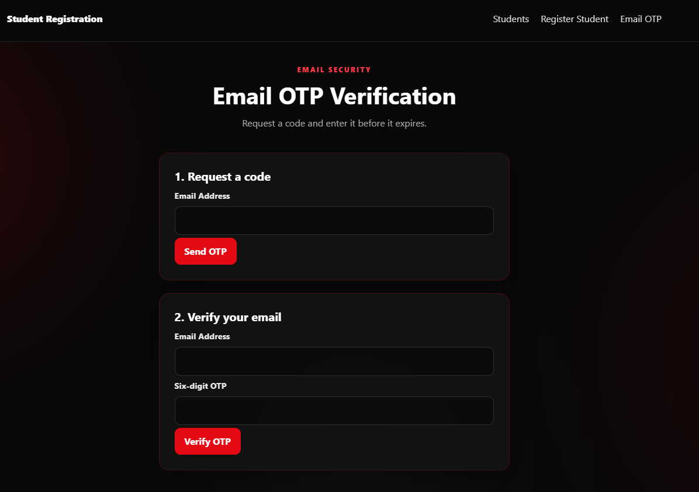
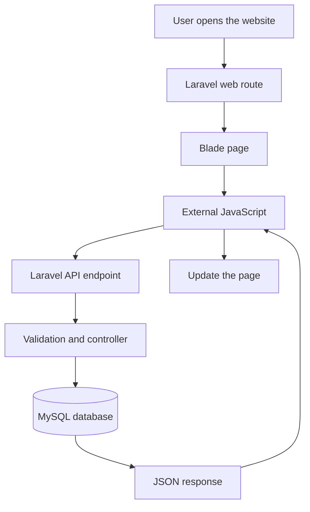

<div align="center">



<p>
  
  
  
  
</p>

<strong>Build. Understand. Improve.</strong>

</div>

---

## About the project

The **Student Registration System** is a learning project that demonstrates how a Laravel application can combine a server-rendered interface with API-based data operations.

The user interface uses **Blade templates**, external CSS, and JavaScript. Student records are read and changed through Laravel API endpoints. A separate email OTP page lets a user request and verify a six-digit code.

The interface uses a **red-and-black glassmorphism theme**, with translucent panels and a slowly moving aurora-style background.

> **For beginners:** A web page, an API endpoint, and a database are three different parts of the application. The page is what a person sees; the API exchanges data; the database stores the records.

## Screenshots

### Student records

The student listing is intended to display each record with its student ID, name, email, course, year level, and available actions.



### Email OTP verification

The OTP page separates requesting a code from submitting the code for verification.



---

## Technology stack

| Technology | What it does in this project |
|---|---|
| **Laravel** | Routes HTTP requests and provides the application structure. |
| **PHP** | Implements server-side validation and application logic. |
| **Blade** | Renders the HTML interface from reusable `.blade.php` templates. |
| **JavaScript** | Sends requests to the API and updates the page with returned data. |
| **CSS** | Styles the interface, responsive layouts, glass panels, and aurora animation. |
| **MySQL** | Stores student records. |
| **Laravel Cache** | Stores the short-lived OTP during the verification flow. |
| **SMTP** | Sends the OTP email using the configured mail server. |

## How the application works



### Web routes and API routes are not the same

| URL | Purpose |
|---|---|
| `/` | Redirects to the student registration page. |
| `/students` | Renders the student listing Blade page. |
| `/students/create` | Renders the registration form. |
| `/students/{id}` | Renders a student's details page. |
| `/students/{id}/edit` | Renders the edit form. |
| `/email-otp` | Renders the email OTP interface. |
| `/api/v1/students` | Returns student records as JSON. |
| `/api/v1/email-otp/send` | Requests an OTP email. |
| `/api/v1/email-otp/verify` | Verifies an OTP. |

**Important:** `/api/v1/students` is an API URL. Opening it directly in a browser displays JSON, which is expected. To view the visual student listing, open `/students`.

---

## Project structure

```text
student-registration/
├── app/
│   └── Http/
│       └── Controllers/
│           └── Api/
│               └── V1/
│                   ├── StudentController.php
│                   └── EmailOtpController.php
├── public/
│   ├── css/
│   │   └── app.css
│   └── js/
│       └── app.js
├── resources/
│   └── views/
│       ├── layouts/
│       │   └── app.blade.php
│       ├── students/
│       │   ├── _form.blade.php
│       │   ├── create.blade.php
│       │   ├── edit.blade.php
│       │   ├── index.blade.php
│       │   └── show.blade.php
│       └── otp/
│           └── index.blade.php
├── routes/
│   ├── api.php
│   └── web.php
└── README.md
```

*This is a simplified map of the files relevant to the frontend and API. A standard Laravel installation contains additional framework files and directories.*

---

## Getting started

These steps assume PHP, Composer, Laravel's requirements, and MySQL are already installed. If you are using Laragon on Windows, start the required services first.

### 1. Open the project

In a terminal, move into the project directory:

```bash
cd F:\APPS\laragon\www\student-registration
```

Use your own project path if it is different.

### 2. Install PHP dependencies

```bash
composer install
```

### 3. Configure the environment

If `.env` does not exist, copy the example file:

**Windows CMD**
```bat
copy .env.example .env
```

**PowerShell**
```powershell
Copy-Item .env.example .env
```

Generate the application key if needed:

```bash
php artisan key:generate
```

Edit `.env` and configure your database connection. Example values:

```dotenv
APP_NAME="Student Registration"
APP_ENV=local
APP_DEBUG=true
APP_URL=http://127.0.0.1:8000

DB_CONNECTION=mysql
DB_HOST=127.0.0.1
DB_PORT=3306
DB_DATABASE=student_registration
DB_USERNAME=root
DB_PASSWORD=
```

Use the database name, username, and password that actually exist on your machine. The values above are examples; do not overwrite working settings without checking them first.

### 4. Prepare the database

Create the configured database in MySQL if it does not already exist, then run:

```bash
php artisan migrate
```

Only run migrations that belong to this project. Back up existing data before changing a database schema.

### 5. Configure email

Set the SMTP settings in `.env` using the credentials and provider settings for your mail account. Do not commit passwords, app passwords, or other secrets to GitHub.

The OTP endpoint uses the application's mail configuration. OTP delivery will not work until the SMTP configuration is valid.

### 6. Clear cached configuration and routes

```bash
php artisan optimize:clear
```

### 7. Start the development server

```bash
php artisan serve
```

Open these pages in your browser:

- **Registration:** `http://127.0.0.1:8000/students/create`
- **Student listing:** `http://127.0.0.1:8000/students`
- **Email OTP:** `http://127.0.0.1:8000/email-otp`

The Laravel development server prints the local address in the terminal. Use that address if it differs from the example above.

---

## Student CRUD: what to test

CRUD stands for **Create, Read, Update, and Delete**.

1. **Create:** Open the registration form and submit valid student details.
2. **Read:** Open the Students page and confirm that the new record appears.
3. **View:** Select View to open the record's details page.
4. **Update:** Select Edit, change a field, and save the record.
5. **Delete:** Select Delete and confirm the action. Verify that the record no longer appears.

The API validates fields such as `student_id`, `first_name`, `last_name`, `email`, `course`, and `year_level`. Student ID and email must be unique when creating a record.

## Email OTP flow

1. Enter an email address and request a code.
2. Check the inbox associated with the configured SMTP account.
3. Enter the same email address and the six-digit code.
4. Submit the verification form.

The OTP is designed to expire after **five minutes**. If a code is invalid or expired, request a new one. A successful verification consumes the code.

> Email OTP verification in this project is an example flow. Do not treat it as a complete production authentication system without additional security review, rate limiting, abuse prevention, and appropriate account/session handling.

---

## Design details

- **Palette:** near-black backgrounds, red accents, and restrained white highlights.
- **Glassmorphism:** translucent panels, soft borders, and blurred surfaces.
- **Aurora effect:** moving red and crimson light fields with a subtle neutral glow.
- **Responsive layout:** forms and tables adapt to smaller screens.
- **Reduced-motion support:** the stylesheet respects the user's reduced-motion preference.

The background animation is decorative. It should not block clicks or interfere with form submission.

## Troubleshooting

### The browser displays JSON instead of the student page

You probably opened the API endpoint. Use `/students` for the Blade page and `/api/v1/students` for the JSON response.

### The student list is empty

- Confirm the API returns records at `/api/v1/students`.
- Check the browser developer tools' **Console** and **Network** tabs.
- Confirm the frontend JavaScript calls the expected API URL.
- Confirm the API and web routes are registered with `php artisan route:list`.

### A page returns 404

- Confirm the corresponding web route exists.
- Confirm the Blade file is in the correct `resources/views` folder.
- Run `php artisan optimize:clear`.
- Remember that `students.create` refers to `resources/views/students/create.blade.php`.

### OTP emails are not arriving

- Check SMTP host, port, encryption, username, and password in `.env`.
- Check spam/junk folders and the Laravel log at `storage/logs/laravel.log`.
- Confirm the configured mail provider permits SMTP sending.

### CSS or JavaScript changes do not appear

- Hard-refresh the browser with **Ctrl + F5**.
- Confirm the layout loads `public/css/app.css` and `public/js/app.js`.
- Inspect the browser's Network tab for missing asset requests.

---

## Security notes

- Keep `.env` out of version control.
- Do not commit mail credentials, database passwords, or real OTP codes.
- Validate all input on the server; client-side validation alone is insufficient.
- Protect destructive operations and review authorization before deploying publicly.
- Use HTTPS and production-appropriate error handling for deployment.
- Configure rate limits for OTP requests and verification attempts before production use.

## Beginner learning path

If you are new to Laravel, explore the project in this order:

1. **Blade layout:** learn how `layouts/app.blade.php` is reused by individual pages.
2. **Web routes:** learn how `/students` returns an HTML page.
3. **Forms:** inspect `_form.blade.php` and the field names used by validation.
4. **JavaScript fetch:** trace how the browser sends a request to `/api/v1/students`.
5. **Controller validation:** inspect `StudentController` to understand server-side rules.
6. **Database:** follow the model and migration to understand how records are stored.
7. **OTP flow:** compare the send and verify endpoints, cache expiry, and mail configuration.

## Contributing

For learning or class use, a useful contribution can include a bug fix, a clearer explanation, accessibility improvements, tests, or a documented feature. Keep changes focused and never include secrets in commits.

## License

No license has been specified in this README. Add a license file and update this section before redistributing the project.

---

<div align="center">

**Built as a learning project with Laravel, Blade, JavaScript, CSS, MySQL, and email OTP.**

<sub>Red interface. Clear separation of concerns. Learn one layer at a time.</sub>

</div>
